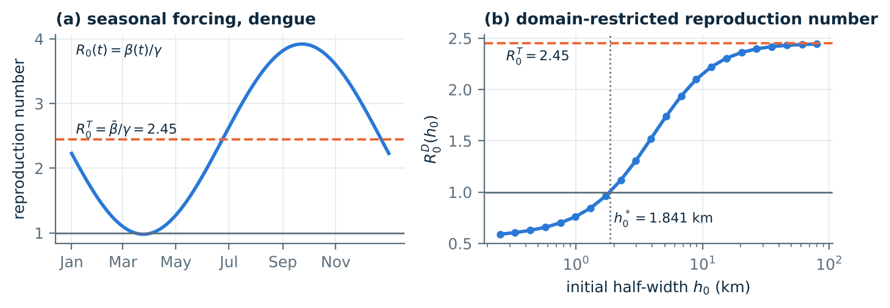
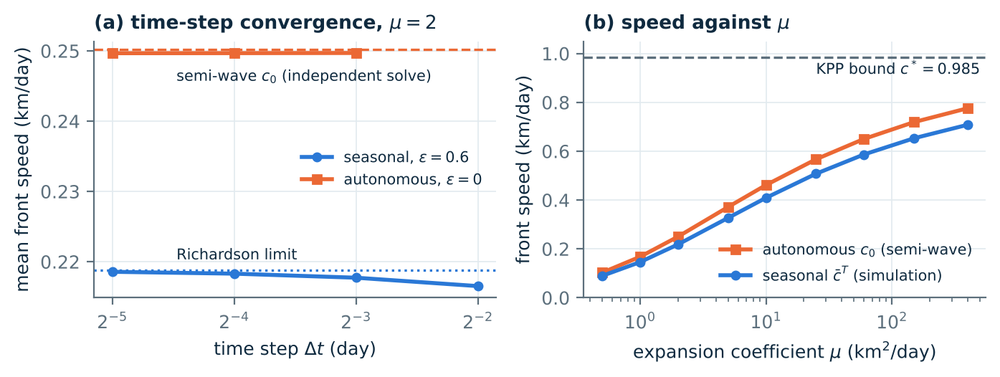
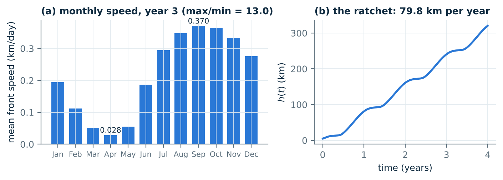
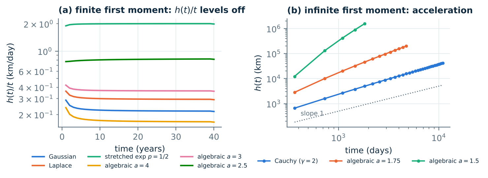
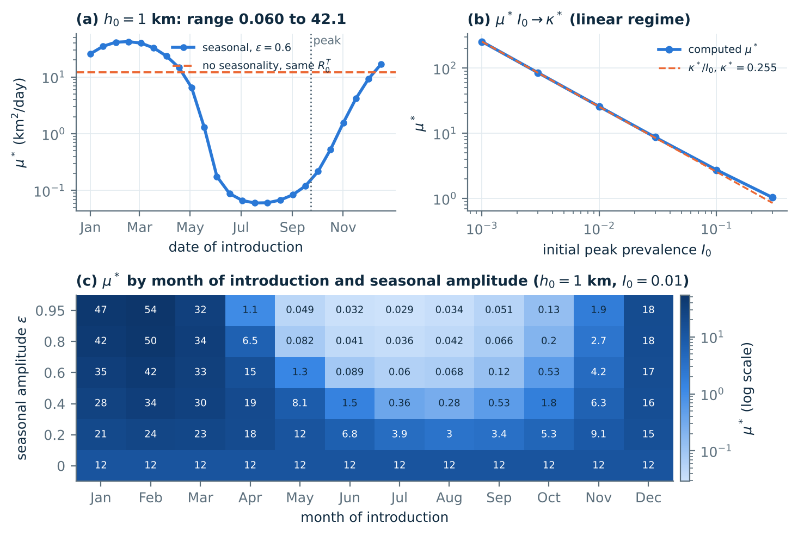
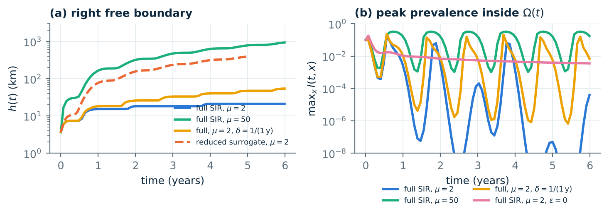
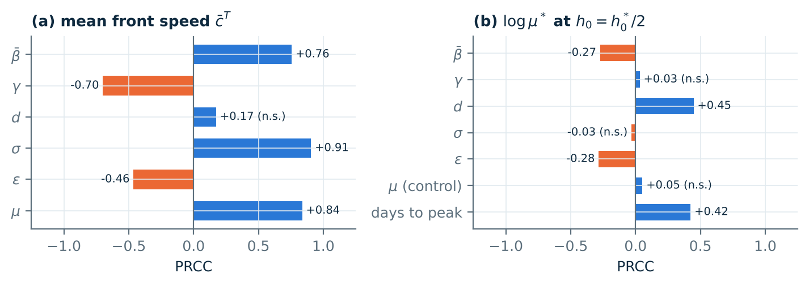

<div align="center">

# Seasonal Nonlocal SIR Model with Two Free Boundaries

**How does a seasonal disease like dengue spread into new areas, and does the time of year matter?**


</div>

---

## 👥 Team (Group G3)

| # | Name | Roll number |
|:-:|:-----|:-----------:|
| 1 | Khushi | LCB2024007 |
| 2 | Diyanshu Kumar | LCI2024015 |
| 3 | Ramesh Bijarniya | LCI2024045 |
| 4 | Satyavrat Rai | LCI2024022 |

**Research topic:** *Dynamics for a nonlocal diffusive SIR epidemic model with double free boundaries* (Zhang and Wang, Nonlinear Analysis: RWA 81, 2025), extended to seasonal transmission.

---

## 📌 The idea in one picture

- People are split into three groups: **S** (can catch the disease), **I** (infected) and **R** (recovered).
- The infected area is an interval from **g(t)** to **h(t)**. Its two ends move outward as the infection pushes them.
- People can jump long distances (nonlocal dispersal), not only to nearby places.
- The infection rate **β(t)** goes up and down every year, like dengue after the monsoon.

We ask three questions:

1. 🦠 Will the infection **spread forever or die out**?
2. 🏃 If it spreads, **how fast** does the front move?
3. 📅 Does the **date the infection arrives** change the answer?

---

## 🧮 The model

**Infected people** (only inside the infected area):

$$
\frac{\partial I}{\partial t} = d_2\left(\int_{g(t)}^{h(t)} J(x-y)\,I(t,y)\,dy - I\right) + \beta(t)\,S\,I - (\gamma+\delta)\,I
$$

**Susceptible people** (everywhere):

$$
\frac{\partial S}{\partial t} = d_1\left(\int_{\mathbb{R}} J(x-y)\,S(t,y)\,dy - S\right) + \Lambda - \delta S - \beta(t)\,S\,I
$$

**Recovered people** (only inside the infected area):

$$
\frac{\partial R}{\partial t} = d_3\left(\int_{g(t)}^{h(t)} J(x-y)\,R(t,y)\,dy - R\right) + \gamma I - \delta R
$$

**How the right edge moves** (the left edge is the mirror image):

$$
h'(t) = \mu \int_{g(t)}^{h(t)} I(t,x)\,G\big(h(t)-x\big)\,dx, \qquad G(r) = \int_r^{\infty} J(z)\,dz
$$

**Seasonal infection rate:**

$$
\beta(t) = \bar\beta\left[1 + \varepsilon \cos\left(\frac{2\pi (t-\varphi)}{365}\right)\right]
$$

<details>
<summary><b>📖 What each symbol means (click to open)</b></summary>

| Symbol | Meaning |
|:------:|:--------|
| $J(x-y)$ | chance of jumping from place $y$ to place $x$ (the kernel) |
| $d_1, d_2, d_3$ | how often S, I and R people move |
| $\bar\beta$ | average infection rate over the year |
| $\varepsilon$ | strength of the season (0 means no season) |
| $\varphi$ | day of the year when infection peaks |
| $\gamma$ | recovery rate |
| $\delta$ | birth and death rate |
| $\mu$ | how easily the edge of the infected area moves |
| $h_0$ | half width of the first infected area |

</details>

We also study a **simple model** that keeps $S$ fixed and uses one equation for $I$.

---

## 🔑 Main results

| Result | What we found |
|:-------|:--------------|
| 📐 **Thresholds** | They depend only on the **yearly average** infection rate (a short new proof). |
| 🐢 **Speed** | Seasons make the front **9 to 13% slower**, even with the same average. |
| 📅 **Arrival date** | The critical value μ* changes **about 700 times** with the arrival date (0.060 in July, 42 in February). |
| 🚀 **Speeding up** | The front speeds up **only** when the average jump length is infinite (tested on 9 kernels). |
| 🛑 **Full model** | With lifelong immunity the front **stops** after 2 to 3 seasons, while the simple model keeps going. |

### Three example diseases

| Disease | Average R₀ | Critical half width (km) | Front speed (km per year) |
|:--------|:----------:|:------------------------:|:-------------------------:|
| 🦟 Dengue | 2.45 | 1.84 | 80 |
| 🤧 Influenza | 1.68 | 9.93 | 150 |
| 💧 Cholera | 1.50 | 1.73 | 27 |

---

## 📊 Figures

| | |
|:-:|:-:|
|  |  |
| **Fig 1.** Seasonal R₀ and the critical size | **Fig 2.** Checking the solver and speed vs μ |
|  |  |
| **Fig 3.** Fast in autumn, almost still in spring | **Fig 5.** Which kernels make the front speed up |

<details>
<summary><b>More figures (click to open)</b></summary>

**Fig 4.** Arrival date and the critical value μ*



**Fig 6.** Full model compared with the simple model



**Fig 7.** Sensitivity analysis



</details>

---

## 🚀 Quick start

```bash
# 1. Download the code
git clone https://github.com/YOUR-USERNAME/periodic-nonlocal-sir-fb.git
cd periodic-nonlocal-sir-fb

# 2. Install the packages
pip install -r requirements.txt

# 3. Run the studies (each one saves its results in results/)
cd scripts
python s01_thresholds.py
python s08_figures.py
```

<details>
<summary><b>⏱️ All scripts and how long they take</b></summary>

| Script | What it does | Time |
|:-------|:-------------|:----:|
| `s01_thresholds.py` | Thresholds R₀, h₀* and the proof check | seconds |
| `s02_convergence.py` | Checks the solver with finer grids | ~5 min |
| `s03_speed_mu.py` | Front speed for different μ | ~5 min |
| `s04_mustar.py` | Critical value μ* and arrival date | ~3 min |
| `s05_acceleration.py` | Nine kernels over 8 to 40 years | ~20 min |
| `s05b_rates.py` | Growth rates for the kernel runs | seconds |
| `s05c_fastkernels.py` | Very heavy kernels on a large grid | ~5 min each |
| `s06_full_sir.py` | Full model vs simple model | ~5 min |
| `s06b_full_diagnostics.py` | Why the full model front stops | ~3 min |
| `s07_sensitivity.py` | Sensitivity analysis (200 samples) | ~15 min |
| `s08_figures.py` | Makes all figures | seconds |

</details>

---

## 📁 Folder layout

```
periodic-nonlocal-sir-fb/
├── sirfb/
│   ├── core.py        model, kernels, thresholds and the simulator
│   └── semiwave.py    separate check of the front speed
├── scripts/           one script for each study (s01 to s08)
├── results/           numbers saved by each script (JSON)
├── figures/           all figures used in the paper
├── requirements.txt
├── LICENSE
└── README.md
```

---

## 📚 Main references

1. Q. Zhang, M. Wang, *Dynamics for a nonlocal diffusive SIR epidemic model with double free boundaries*, Nonlinear Anal. RWA 81 (2025) 104208.
2. J.-F. Cao, Y. Du, F. Li, W.-T. Li, *The dynamics of a Fisher-KPP nonlocal diffusion model with free boundaries*, J. Funct. Anal. 277 (2019).
3. Y. Du, W. Ni, *Spreading speed for some cooperative systems with nonlocal diffusion and free boundaries, part 1*, J. Differential Equations 308 (2022).
4. Y. Du, W. Ni, *Rate of propagation for the Fisher-KPP equation with nonlocal diffusion and free boundaries*, J. Eur. Math. Soc. 27 (2025).
5. T. Wang, Z. Li, B. Dai, *Semi-wave and spreading speed for a nonlocal diffusive Fisher-KPP model with free boundaries in time periodic environment*, DCDS-B 29 (2024).

**Data:** dengue case counts from the [National Center for Vector Borne Diseases Control, India](https://ncvbdc.mohfw.gov.in/Doc/Dengue-Cases-deaths-2021-2026-till-April.pdf). The parameter values are examples and are not fitted to this data.

---

<div align="center">

Made by **Group G3** · Released under the [MIT License](LICENSE)

</div>
